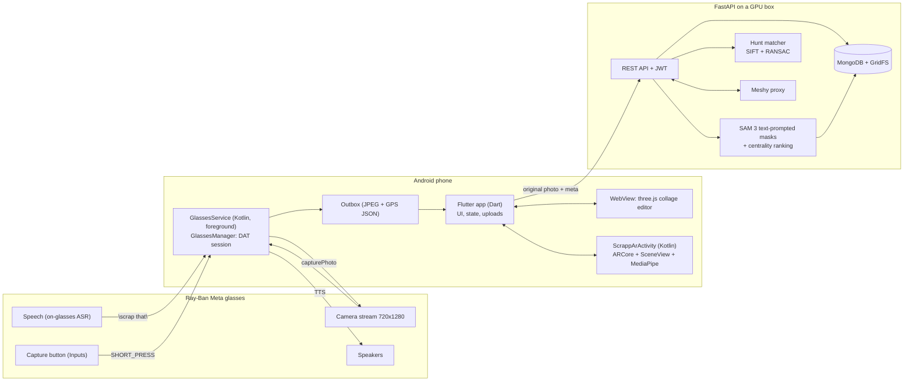
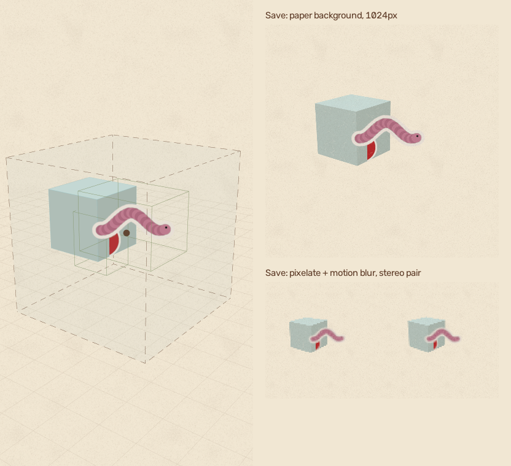

# Scrapp architecture

Scrapp is an AR scrapbook for Meta's displayless AI glasses (Ray-Ban Meta Gen 1/2, Oakley Meta HSTN/Vanguard). You say **"scrap that"** or press the glasses' capture button. The glasses take a photo, the server cuts the most central objects into die-cut stickers, and the original photo and its location are kept. In the app you collage stickers and AI-generated 3D models in space. You can send stickers that anchor to real objects ("hold up an apple"), and build geo-tagged scavenger hunts that friends play with their own glasses.



## 1. What changed from the Quest Pro spec

| Original (Quest Pro) | Now (AI glasses + phone) | Why |
|---|---|---|
| Press-and-hold capture, up to 5 s of frames + eye-tracking pairs | One still per trigger: voice "scrap that" or a capture-button press | The glasses have no eye tracking and no app-controlled display; one 720p still is enough for stickers and is fast over Bluetooth |
| Stitch frames by feature matching | Dropped | Single frame; the stitching step existed to widen a headset's field of view |
| Gaze samples pick the object | **Head-direction prior**: masks closest to the centre of the head-mounted camera rank highest | The wearer is facing what they care about when they speak; this replaces gaze |
| Python/OpenCV/SAM 2 off-board pipeline | Same idea: FastAPI + SAM 3 on a GPU server | Matches your answer: server SAM only |
| 3D collage built in the headset | 3D collage built on the phone (three.js), viewable in AR and on the web | Glasses can't render; the phone is the canvas |
| Off-axis projection | Not built | Needs head tracking against a fixed screen; left for later |
| Web viewer, 3DS, IG, Pinterest, Tumblr | Web viewer link, stereo side-by-side export ("3DS-style" pair, not MPO), system share sheet for IG/Pinterest/Tumblr | Share sheet covers every installed app without per-network SDKs |
| Geospatial anchoring + scavenger hunt | Built: geofence + visual match on glasses; image/object/geo anchors on phone | Museums are indoors where GPS/VPS are weak, so the artwork itself is the anchor |
| MongoDB or Supabase | MongoDB (+ GridFS for images) | You asked for MongoDB |

## 2. Stack and why

| Layer | Choice | Why |
|---|---|---|
| App UI, state, networking | **Flutter (Dart)** | One codebase for Android now and iOS later |
| Glasses access | **Kotlin**, Meta Wearables Device Access Toolkit (DAT) **1.0.1** | Meta ships DAT only for Kotlin (Android) and Swift (iOS). The community Flutter wrappers on pub.dev wrap DAT 0.7 and lack Inputs (button) and Speech (voice), so Scrapp talks to the official SDK through its own platform channel |
| AR | **Kotlin**, ARCore through **SceneView 4.18.0** (Compose), in its own Activity | Flutter AR plugins are unmaintained. SceneView 4.18 is the newest release that builds on AGP 8 / compileSdk 36, which Flutter and DAT also use |
| "Hold up an apple" detection | MediaPipe Tasks, EfficientDet-Lite0 (COCO 80 classes) | On-device, fast, knows apple/banana/cup/book/etc. |
| 3D collage editor + web viewer | **three.js r187** in a WebView, served from a tiny local HTTP server inside the app | The same file renders in the app and at the public web link. Flutter's native 3D options are still experimental |
| Backend | **Python FastAPI + Motor (MongoDB) + GridFS** | Same language as SAM/OpenCV, so one server codebase |
| Segmentation | **SAM 3** image model (SAM License) on a CUDA GPU | See section 5 |
| 3D generation | **Meshy API** (text-to-3D preview/refine, image-to-3D from a sticker) | API key stays on the server |

Other frameworks only appear where Flutter cannot reach: the glasses SDK and ARCore. Everything else is Dart.

## 3. Getting images from the glasses

All glasses traffic lives in `android/.../glasses/GlassesManager.kt`, owned by `GlassesService` (a foreground service, type `connectedDevice|location`). That way capture keeps working with the phone locked in a pocket.

1. **Registration.** `Wearables.startRegistration(activity)` deep-links into the Meta AI app, which links Scrapp to the glasses and returns via the `scrapp://` URL scheme. Camera and microphone permissions are granted inside the Meta AI app (`Wearables.RequestPermissionContract`).
2. **Session.** "Start scrapbooking" creates a `DeviceSession` (`Wearables.createSession(AutoDeviceSelector())`). Capabilities are attached only after the session reports `STARTED`. If the glasses are folded, taken off or drop out of range, the session ends (`STOPPED` is terminal) and Scrapp opens a new one every 4 s while armed.
3. **Camera.** `session.addCamera(StreamConfiguration(VideoQuality.HIGH, frameRate = 2))` opens a 720x1280 stream at 2 fps, held "warm" so the shutter takes about a second. Turn off **Fast shutter** to open the stream only per capture at 15 fps (slower, saves battery).
4. **Still.** `stream.capturePhoto()` returns `PhotoData.Bitmap` or `PhotoData.HEIC`. HEIC is decoded and rotated by EXIF, then re-encoded as JPEG.
5. **Tagging.** GPS comes from Android's fused provider at shutter time (not upload time). Trigger source, transcript and the active hunt id go with it.
6. **Outbox.** JPEG + JSON are written to `filesDir/outbox` first. Flutter uploads, then acks, which deletes the local copy. Nothing is lost offline; the outbox drains when the app resumes.
7. **Server.** The original is stored in GridFS before any processing and is never modified. Stickers, hunt targets and tap-to-cut all derive from it.

Meta's DAT also has an experimental standalone high-resolution photo API (`camera.photo`). Scrapp uses the in-stream capture because standalone capture is "development and beta only, not publishable".

## 4. Voice and button controls

| Trigger | How it works | Code |
|---|---|---|
| **"Scrap that"** | DAT **Speech** (`session.addSpeech()`) transcribes *on the glasses* and sends text, not audio, over Bluetooth. `VoiceCommandMatcher` fuzzy-matches the phrase, because recognizers produce "scrap book", "scrapple" and even "Scrabble cat". A 2.5 s debounce stops partial and final transcripts from firing twice. "Scrap that lamp" also passes `prompt="lamp"` (see section 5). | `GlassesManager.attachSpeech`, `VoiceCommandMatcher.kt` |
| **Capture button** | DAT **Inputs** (`session.addInputs`) reports `InputEvent.Capture(SHORT_PRESS)` from the `CAPTURE_BUTTON` source | `GlassesManager.attachInputs` |
| **"Hey Meta, start Scrapp"** | DAT **Voice Invocations** cold-launches or foregrounds the app; Scrapp answers `sendSuccess` and arms itself | `startVoiceInvocations`, `MainActivity.onNewIntent` |
| **In-app button** | Same capture path, `trigger=app` | `GlassesBridge.captureNow()` |
| **Spoken feedback** | Android TTS on the media route, which is the glasses' speakers while they're connected: "Scrapbooking", "Scrapbooked. 3 stickers.", "Found Starry Night. 2 of 5." | `GlassesManager.speak` |

During a hunt the same phrase checks the find, so there's no second phrase to remember. "Found it" is also recognised.

**Limits to know about**

- There's no custom wake word. "Hey Meta" belongs to Meta AI. "Scrap that" works only while Scrapp's session is running (after you tap Start or say "Hey Meta, start Scrapp").
- Speech, Inputs and Voice Invocations are **experimental in DAT 1.0.1**. They work in development and beta release channels, but apps using them can't ship to production yet. Each must be enabled for the app in the Wearables Developer Center.
- Speech takes no vocabulary hints; the locale is reported, not set. That's why matching is fuzzy.
- Meta's docs don't say whether a capture-button press handled through Inputs *also* takes the glasses' own photo. Check this on your pair; if it does, the voice trigger alone gives a clean flow.

## 5. Segmentation (stickers)

`backend/app/services/segmentation.py` + `pipeline.py`

1. Decode the original and downscale it so the long side is at most 1536 px (SAM input).
2. **SAM 3 concept segmentation**: the spoken noun from "scrap that <noun>" is the text prompt; with no noun, SAM 3's point predictor is tapped at five points around the frame centre (generic words like "object" find almost nothing). Text detections below `SAM3_CONFIDENCE` are dropped.
3. **Rank** every mask (`rank_candidates`):
   - drop masks under 0.4% or over 65% of the frame, and masks touching 3 or more borders (floor, wall, sky)
   - score = 0.55 x centrality (Gaussian on centroid distance from frame centre) + 0.25 x SAM quality + 0.20 x object-size prior, +0.15 if the mask covers the exact centre
   - remove duplicates and parts of an already-kept object (IoU or containment > 0.6)
   - keep the top 4; the first is the **hero** sticker
4. **Die-cut**: upscale the mask to full resolution, close/open, feather 1 px, dilate a white border (5% of object size), crop, and save a transparent PNG. The mask PNG and the object box in source pixels are stored too.
5. **Tap-to-cut**: in the app, tap anything on the original photo. SAM 3's point predictor (`inst_interactive_predictor`) gets a single positive point and the best of 3 masks becomes a new sticker.

**Alternatives considered**

| Option | Verdict |
|---|---|
| SAM 3 / 3.1 (Nov 2025) | Better when you *name* the object: "scrap that lamp" could segment exactly "lamp" via text prompts. Weights are gated on Hugging Face under Meta's SAM license, and it doesn't do label-free "segment everything" as directly. Scrapp already passes `prompt`, so add a `Sam3Segmenter` as an upgrade. |
| SAM 3D Objects | Could turn a sticker into 3D without Meshy. Research-heavy and GPU-hungry; Meshy is simpler for now. |
| ML Kit Subject Segmentation (on device) | Free and instant, but Android-only and coarser. You chose server SAM. |
| GrabCut (`SEGMENTER=grabcut`) | Included only so the pipeline runs on a laptop without a GPU. Not for real use. |

Unit tests: `backend/tests/test_segmentation.py` (hero is the central object; background and part-masks dropped; sticker has a white outline and a transparent background).

## 6. Sharing, anchoring and scavenger hunts

**Share a sticker** (`POST /shares`) with an anchor:

| Mode | Receiver's experience | Tech |
|---|---|---|
| `object` | "Hold up an apple" and the worm sticks to its side and wiggles | MediaPipe EfficientDet-Lite0 on the AR camera image every 0.6 s. The image is first warped to match the screen view, so the detection centre is directly a screen point. Then ARCore depth hit-test, then a yaw-facing anchor, re-anchored if the apple moves more than 6 cm |
| `image` | Find the original object (e.g. the painting) and the sticker lands on it | The server crops the sender's **original photo** around the sticker and the phone tracks it with ARCore Augmented Images (runtime database) |
| `geo` | Appears where it was made | ARCore Geospatial (Earth) anchor outdoors; tap-to-place fallback |
| `surface` | Tap any surface | ARCore hit test |

Animations: wiggle, bob, spin, pop. Each sticker also does an elastic "pop" when it first appears.

**Scavenger hunt**

1. The creator picks located stickers; the server stores, per item, a crop of the original photo (`target_file_id`), the location and a radius (150 m by default).
2. A friend opens the hunt and taps **Hunt with my glasses**. That sets the active hunt on the native side and arms the glasses.
3. Saying "scrap that" in front of an artwork calls `POST /hunts/{id}/attempt` with the photo and GPS. The server:
   - keeps unfound items whose geofence contains the friend (GPS accuracy is added as slack)
   - runs SIFT + Lowe ratio + RANSAC homography against each target and accepts at 25 or more inliers and a 20% inlier ratio
   - checks off the best match and still makes stickers from the photo for the finder
   The glasses say "Found Starry Night. 2 of 5."
4. Or **Find with phone camera**: the AR view tracks every remaining target, pops the sticker onto the artwork and checks it off.

The geofence narrows the candidates and the image decides. Indoor GPS is too rough to say *which* painting, but a homography match on a flat, textured artwork is very reliable. For things that are not flat (a cup, a plant, a sculpture) there is an **appearance fallback**, used only when SIFT finds nothing (`services/embedding_match.py`): a DINOv2-small embedding (timm, CPU) of each unfound target crop is compared with embeddings of the attempt photo (whole frame, centre crop, 2x2 grid). An item counts as found only if its best view similarity is at least `EMBED_MIN_SCORE` (0.35), it leads the runner-up item by `EMBED_MARGIN` (0.05), and it stands out from the rest of the frame by `EMBED_STANDOUT` (0.08, the distractor baseline). The response says `method: "sift"` or `"embedding"`, and progress records `glasses` or `glasses_embedding`. It is optional: if the model cannot load, hunts silently stay SIFT-only (one log line). Calibration on pasted-object tests (rotated, rescaled, dimmed, new background): 7 of 17 true matches accepted, 0 of 17 false accepts. Thresholds are deliberately strict because a wrong tick-off is worse than a miss; tune with real glasses photos. Settings: `EMBED_ENABLED`, `EMBED_MODEL`, `EMBED_DEVICE`.

Tests: `backend/tests/test_matching.py` (same artwork seen at an angle on a wall matches; a different artwork does not).

## 7. 3D collage editor (spec mapping)

`app/assets/web/editor.js` (three.js) + `lib/screens/collage_editor_screen.dart` (paper toolbar)



| Spec item | Implementation |
|---|---|
| 3D collage from captures | Stickers become textured planes; Meshy GLBs load with GLTFLoader, normalised to 0.5 units |
| Manipulation | Tap to select. Drag modes: move (camera-parallel plane), rotate, scale, depth. Two-finger pinch scales and twists. Orbit when nothing is grabbed |
| Customizable bounding box with green save zone / red exclude zone | Dashed box. Each item's outline turns green inside and red outside; live "N in box / M left out" counter |
| Presets that snap from a central anchor | square, portrait, landscape, tower, panorama; the centre stays fixed and only the size changes. "Center on selection" moves the anchor |
| Save resolution presets | 1080 / 2048 / 4096 px on the long side |
| Saving doesn't clear the workspace; animation to the collection | Export renders only in-zone items (helpers hidden) and leaves the scene untouched; `showSavedBurst` pops the render and flies it into the collection |
| Manual clear: all, inside, outside | Clear menu |
| Filters: motion blur, pixelation | Live: AfterimagePass + RenderPixelatedPass. Export: true motion blur (10 jittered sub-frames averaged) and pixelation scaled to the export size |
| Web viewer, IG/Pinterest/Tumblr, 3DS | `POST /collages/{id}/publish` creates a public link served by the same editor in view mode; system share sheet for the PNG; stereo side-by-side export |
| Mesh generation elements | Fuzzy grass texture everywhere 3D generation appears; GLB preview on a grass pedestal |

Verified in headless Chrome: stickers and a GLB load, the zone counts update (3 inside, 1 outside), and paper, pixelated and stereo exports render.

## 8. Backend

**Collections**

| Collection | Key fields |
|---|---|
| `users` | username (unique), email (unique), password_hash (bcrypt), display_name |
| `friendships` | requester_id, addressee_id, status pending/accepted |
| `captures` | owner_id, **original_file_id**, captured_at, location (GeoJSON, 2dsphere), accuracy_m, altitude_m, place_name, trigger, transcript, prompt, status, sticker_ids, hero_sticker_id, hunt_id |
| `stickers` | owner_id, capture_id, image_file_id (PNG), mask_file_id, bbox, crop_box, score, is_hero, location, place_name |
| `collages` | owner_id, title, scene (JSON below), thumbnail_file_id, public_token |
| `meshes` | owner_id, source text/sticker, prompt, meshy_task_id, stage preview/refine/image, status, progress, glb_file_id |
| `shares` | from_id, to_id, kind sticker/collage/hunt/mesh, item_id, anchor {mode, object_class, animation, size_m, lat, lng, target_file_id}, message, seen_at |
| `hunts` | owner_id, title, items [{item_id, sticker_id, capture_id, target_file_id, title, hint, location, radius_m, animation}] |
| `hunt_progress` | hunt_id, user_id, found {item_id: {at, method, capture_id}}, completed_at |
| GridFS `media` | originals, sticker PNGs, masks, hunt/share targets, collage renders, GLBs |

Media URLs are **signed** (`/files/{id}?t=<jwt>`, 7 days) when a response is built for an authorised user. Plain `Image.network`, three.js and the web viewer can then load them without auth headers.

**Collage scene format**

```json
{ "version": 1,
  "items": [{ "id": "i1", "kind": "sticker|mesh", "ref_id": "<sticker or mesh id>",
              "position": [x,y,z], "quaternion": [x,y,z,w], "scale": 1.0 }],
  "zone": { "center": [x,y,z], "size": [w,h,d] },
  "background": { "type": "color", "value": "#3E6B89" },   // optional; absent = the default paper
  "filters": { "pixelate": 0, "motionBlur": 0 },
  "camera": { "position": [x,y,z], "target": [x,y,z] } }
```

`background` is the backdrop behind the collage. One of `{type:"color", value:"#rrggbb"}`, `{type:"paper"}`,
`{type:"gradient", colors:[2-4 "#rrggbb"], angle:0-360}` (CSS degrees, 180 = top to bottom) or `{type:"photo", ref_id:"<your capture id>"}`.
The server validates and normalises it on save (unknown keys dropped; a photo must be one of the owner's captures) and, like sticker
and mesh links, attaches a fresh signed `url` for a photo whenever the collage is read, including the public `/c/{token}` viewer
(so a published collage shows that capture's original photo to anyone with the link). The editor paints it behind the WebGL canvas
and into saved PNGs; a collage without `background` looks exactly as before. If the photo is later deleted, `url` is null and the
collage falls back to the default paper.

**Endpoints** (interactive docs at `/docs` when the server runs)

| Area | Endpoints |
|---|---|
| Auth | `POST /auth/register`, `POST /auth/login`, `GET /auth/me` |
| Captures | `POST /captures` (multipart image + meta), `GET /captures`, `GET /captures/{id}`, `POST /captures/{id}/point`, `POST /captures/{id}/reprocess`, `DELETE /captures/{id}` |
| Stickers | `GET /stickers?scope=mine|received`, `GET/PATCH/DELETE /stickers/{id}` |
| Collages | `POST /collages`, `PUT /collages/{id}`, `GET /collages`, `GET /collages/{id}`, `POST /collages/{id}/publish`, `GET /public/collages/{token}`, `GET /c/{token}` (viewer) |
| 3D | `POST /meshes/text`, `POST /meshes/from-sticker`, `GET /meshes`, `GET /meshes/{id}` (advances the Meshy job) |
| Social | `GET /users/search`, `GET /friends`, `POST /friends/request`, `POST /friends/{id}/accept`, `POST /shares`, `GET /shares/inbox`, `POST /shares/{id}/seen` |
| Hunts | `POST /hunts`, `GET /hunts`, `GET /hunts/{id}`, `POST /hunts/{id}/start`, `POST /hunts/{id}/attempt`, `POST /hunts/{id}/items/{item}/found` (phone AR; optional `lat`/`lng`/`accuracy_m` keep the geofence), `GET /hunts/{id}/progress` (owner: each player's found/total), `DELETE /hunts/{id}` (also removes progress and shares). Hunt output includes `completed` and `completed_at`. |

The skeleton runs segmentation as a FastAPI background task in the API process. Before many users, move it to a worker queue (e.g. arq/Redis or Celery) so GPU work doesn't share the web process.

## 9. Android vs iOS, and what affects the glasses

| Question | Answer |
|---|---|
| Can the glasses part be tested on Android? | **Yes; this build targets Android.** Android 12+ (minSdk 31 here; DAT itself supports Android 10+), Meta AI app installed, glasses paired, Developer Mode on |
| On iOS? | Meta's DAT supports iOS 15.2+ (Swift). The Flutter UI, backend, collage editor and web viewer work on iOS, but the native glasses bridge and AR activity are Android-only in this build. iOS needs Swift ports: DAT bridge + ARKit view |
| Emulator? | No real glasses (no Bluetooth to the glasses) and no ARCore camera. Use a physical phone. Meta's **MockDeviceKit** (Settings → Developer → Mock glasses) simulates paired glasses on a real phone, using the phone camera as the glasses feed |
| Phone requirements for AR | ARCore-supported device with Google Play Services for AR. Depth API (better object anchoring) is on many but not all phones; without it, instant placement is used |
| Geo anchors | ARCore Geospatial needs an API key, internet and outdoor street-level imagery coverage; weak indoors |
| Battery / thermals | A warm 2 fps stream + on-glasses speech drains the glasses faster. Turn off Fast shutter for long museum days |
| Background | Works through the foreground service. Aggressive OEM battery savers (some Samsung/Xiaomi settings) can still kill it; exempt Scrapp from battery optimisation |
| Bandwidth | Bluetooth streams top out at 720p; stills arrive in about a second |
| Distribution | Experimental DAT features (Speech, Inputs, Voice Invocations) can't be published to production yet; use the Developer Center's beta release channel for testers |

## 10. What's skeleton vs done

Done and tested here: the segmentation ranking and sticker die-cut, hunt matching, the voice phrase matcher (mirror test), and the three.js editor (headless Chrome).

Written against the current SDK docs and samples but **not compiled in this environment** (no Flutter/Android SDK available here): the Dart app and Kotlin modules. Expect a short round of compile fixes on first build.

Next steps, roughly in order:

1. First build and on-glasses check of the capture-button behaviour
2. Worker queue for SAM
3. SAM 3 text prompts for "scrap that <noun>"
4. iOS Swift bridge
5. Push notifications for shares
6. Embedding vote for 3D hunt objects: built as a SIFT fallback (see section 6); still to tune on real glasses photos
7. Off-axis projection
